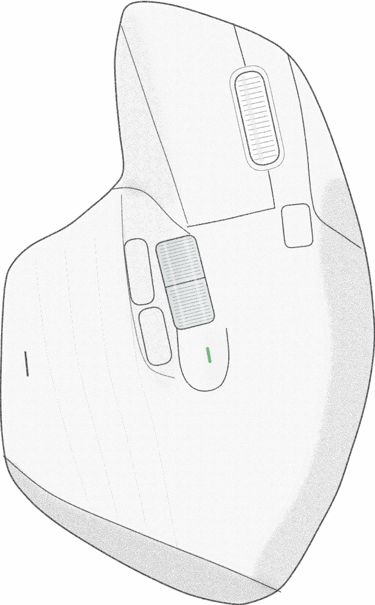
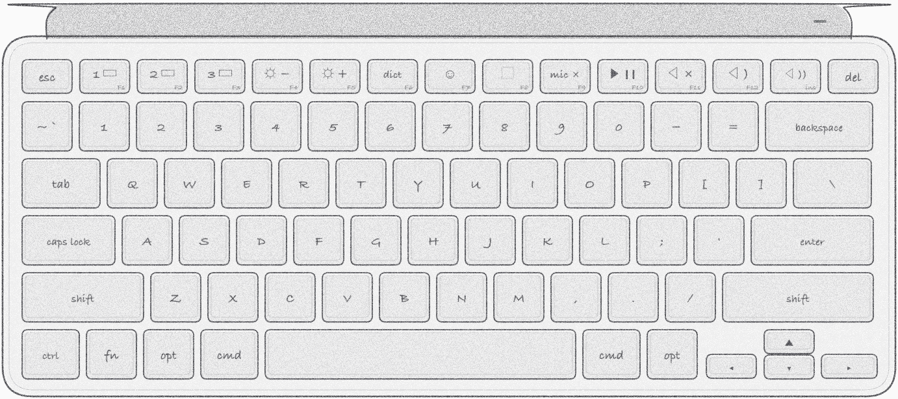

# MXCtl — a tiny Logi Options+ replacement for MX Master 3S and MX Keys Mini on Mac

**English** · [Русский](README.ru.md)

<p align="center">
  
  &nbsp;&nbsp;
  
</p>

**MXCtl** is a native macOS menu bar app that does what Logi Options+ does for the **MX Master 3S**
mouse and the **MX Keys Mini** keyboard, and has **smooth scrolling like Mos built in**, at a
fraction of the cost: ~25 MB of memory instead of ~342 MB, 6.3 MB on disk instead of ~3.5 GB, and
no telemetry, accounts or updater.

It talks to the devices directly over Bluetooth with Logitech's HID++ 2.0 protocol, the same way
Options+ does, so keys and buttons are taken over on the device itself instead of being guessed
from ordinary key presses.

The interface is in English or Russian: the system language by default, or chosen in Settings → General.

## Features

- **Any key or button can be reassigned**: a key combination, a macOS function (Mission Control,
  App Exposé, desktops, mic mute…), a media key, opening an app or a URL, a Shortcuts command or a
  shell command. Everything else keeps working as the device intends.
- **Settings like Options+**: a drawing of the device with a dot on every button; click a dot to
  set its action. "Identify a key" names any key you press.
- **Thumb gesture button**: click → Mission Control; hold and move the mouse → switch desktops
  (like a trackpad), Mission Control or App Exposé.
- **Mic mute** (F9 by default) with a red tab on the edge of every screen while the mic is muted.
- **Smooth scrolling** (see below), reverse wheel direction, SmartShift threshold.
- **Battery**: charge in the menu bar panel, notifications at 15 % and 5 %, last full charge,
  drain per day and a graph for the year.
- **Keyboard backlight** switched off when the Mac sleeps or the screens go dark, and back on at
  wake.
- **Event journal** (`~/Library/Application Support/MXCtl/events.jsonl`): sleep and wake, lock,
  connects, battery and backlight changes, for your own automations.

## Smooth scrolling: Mos built in

MXCtl includes its own equivalent of [Mos](https://github.com/Caldis/Mos) by Caldis, the popular
smooth-scrolling app for macOS, so you do not need to run Mos next to it. It scrolls the same way:
each wheel notch adds a distance, every display frame moves a share of what is left, and a short
filter softens the start. Step, speed and duration are in Mos's units, so the values you used in
Mos mean the same here. The wheel direction can be reversed (vertical and horizontal separately);
trackpad and Magic Mouse scrolling is left alone.

The smoothing is written from scratch in Swift for MXCtl; no Mos code is included. Thanks to Caldis
for Mos, which this part is modelled on.

## Measured

Measured on one machine, a MacBook Pro with Apple M3 Pro on macOS 26, with the same load for
each (`scripts/profile.py`: a minute idle, 30 s of wheel, mouse and gestures). CPU percentages
depend on the processor and will differ on other Macs; what carries over is the ratio between
the two (about 6× less CPU while working).

| | Memory | CPU idle | CPU active | Disk |
|---|---|---|---|---|
| Logi Options+ and Mos | ~342 MB | 2.2 % | 10.6 % | ~3.5 GB |
| MXCtl | ~25 MB | 0.02 % | 1.67 % | 6.3 MB |

Options+'s updater alone wakes the CPU 40–80 times a second; MXCtl ~0. Details in `RESULTS.md` and
`PROFILING.md` (both in Russian).

## Requirements

- macOS 15 or later.
- A Logitech mouse and/or keyboard connected over Bluetooth (see Compatibility).
- Permissions: **Input Monitoring** (HID++ to the devices) and **Accessibility** (smooth
  scrolling, posting keys).
- Quit Logi Options+ and Mos: they grab the same keys and wheel. MXCtl warns when they run.

## Compatibility

MXCtl is made and tested with an **MX Master 3S** and an **MX Keys Mini**. It does not depend on
having both: every Logitech device is set up on its own, and devices of other brands are left
alone. Other models have not been tested; from how MXCtl works, expect this:

| | What works |
|---|---|
| MX Master 3S or MX Keys Mini alone | Everything; settings show just that device. |
| Other Logitech mice and keyboards over **Bluetooth** (MX Master 3, MX Keys, MX Anywhere…) | Buttons and keys that the device lets software take over can be reassigned in "All buttons as a list" (unknown ones are named by their code, e.g. "Button 0x00C5"). No device drawing. SmartShift and the keyboard backlight where the device has them. |
| Older Logitech devices (roughly before 2020, e.g. MX Master 2S) | As above, but no battery level: they report it in an older way MXCtl does not read. |
| Logitech devices through a **Unifying or Bolt USB receiver** | Not supported: MXCtl talks to devices over Bluetooth only. |
| Any mouse, any brand | Smooth scrolling and wheel reversal (trackpads and Magic Mouse are left alone). |

The default actions — F8 → area screenshot (⌘⇧4), F9 → mic mute, the thumb button's click and
swipes — are tied to the control codes of these two devices. Another mouse with the same thumb
gesture button (MX Master 3, MX Master 2S) gets the swipes too; on a keyboard with a different top
row, F8/F9 may be other keys or missing, and you set them in the list.

## Build

Needs Xcode and [XcodeGen](https://github.com/yonaskolb/XcodeGen).

```bash
scripts/install.sh
```

builds a Release copy and installs it to `~/Applications/MXCtl.app`. It is ad-hoc signed; to keep
the macOS permissions across rebuilds, sign it with a local code-signing certificate of your own
(the script uses one named "dmemruk Local Code Signing" when it exists). Tests: `scripts/test.sh`.

The device drawings are made by `scripts/make-device-art.py` (needs `rsvg-convert`; Pillow makes
the PNGs smaller).

## Bug reports

Settings → General → "Report a Bug…" (or right-click the menu bar icon): with Mail as the default
mail app, a new e-mail to contact@memruk.dev with a template to fill in, the MXCtl and macOS
versions, the Mac model, the permissions and the devices found, and the log attached. With any
other mail app (web mail cannot take attachments), the same report with the last 300 lines of the
log opens as text to copy and paste into an e-mail.

## License

MIT, see [LICENSE](LICENSE).

---

MXCtl is an independent project, not made by or affiliated with Logitech. Logitech, Logi, MX Master
and MX Keys are trademarks of Logitech.
