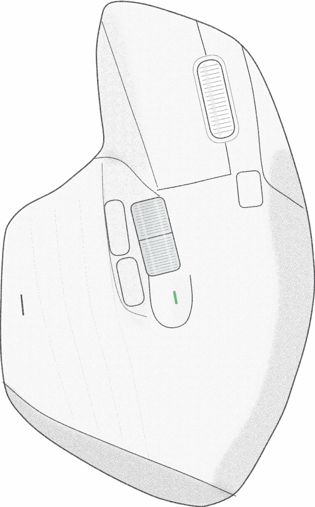
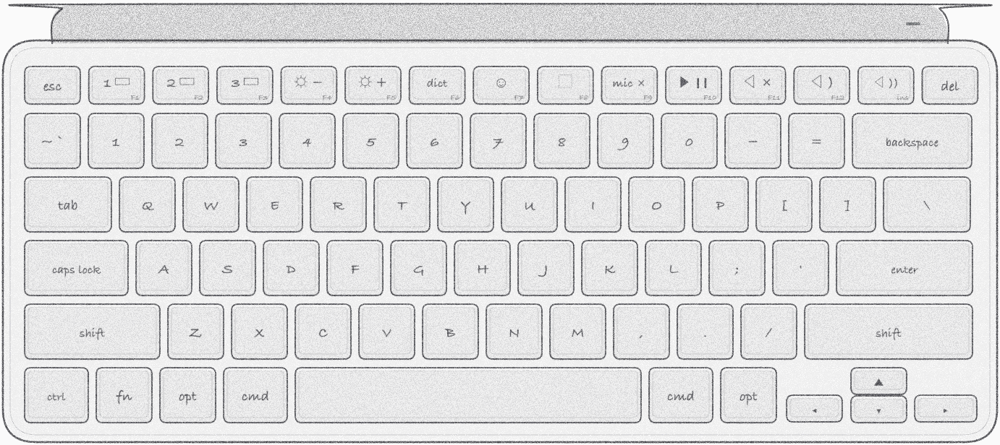

# MXCtl — маленькая замена Logi Options+ для MX Master 3S и MX Keys Mini на Mac

[English](README.md) · **Русский**

<p align="center">
  
  &nbsp;&nbsp;
  
</p>

**MXCtl** — нативное приложение для строки меню macOS. Оно делает для мыши **MX Master 3S** и
клавиатуры **MX Keys Mini** то же, что Logi Options+, и **умеет плавную прокрутку, как Mos**, но
обходится гораздо дешевле: ~25 МБ памяти вместо ~342 МБ, 6,3 МБ на диске вместо ~3,5 ГБ, без
телеметрии, учётных записей и программы обновления.

Оно говорит с устройствами напрямую по Bluetooth на протоколе Logitech HID++ 2.0, как и Options+,
поэтому клавиши и кнопки перехватываются на самом устройстве, а не угадываются по обычным нажатиям.

Интерфейс на русском или английском: по умолчанию язык системы, сменить можно в Настройки → Общие.

## Возможности

- **Любую клавишу или кнопку можно переназначить**: сочетание клавиш, функция macOS (Mission
  Control, App Exposé, рабочие столы, выключение микрофона…), медиаклавиша, открытие приложения
  или ссылки, команда Shortcuts или shell-команда. Всё остальное работает, как задумано
  устройством.
- **Настройки как в Options+**: рисунок устройства с точкой на каждой кнопке; нажмите на точку,
  чтобы выбрать действие. «Определить клавишу» называет любую нажатую клавишу.
- **Кнопка жестов под большим пальцем**: нажатие → Mission Control; зажать и повести мышь →
  переключение рабочих столов (как на трекпаде), Mission Control или App Exposé.
- **Выключение микрофона** (по умолчанию F9) и красная метка у края каждого экрана, пока микрофон
  выключен.
- **Плавная прокрутка** (см. ниже), инверсия колеса, порог SmartShift.
- **Батарея**: заряд в панели строки меню, уведомления при 15 % и 5 %, последняя полная зарядка,
  расход в день и график за год.
- **Подсветка клавиатуры** выключается, когда Mac засыпает или гаснут экраны, и включается при
  пробуждении.
- **Журнал событий** (`~/Library/Application Support/MXCtl/events.jsonl`): сон и пробуждение,
  блокировка, подключения, изменения заряда и подсветки — для своих автоматизаций.

## Плавная прокрутка: Mos внутри

В MXCtl есть свой аналог [Mos](https://github.com/Caldis/Mos) от Caldis, популярного приложения
плавной прокрутки для macOS, поэтому запускать Mos рядом не нужно. Прокрутка работает так же:
каждый щелчок колеса добавляет расстояние, каждый кадр экрана проходит долю оставшегося, а короткий
фильтр смягчает начало. Шаг, скорость и продолжительность — в единицах Mos, так что привычные
значения из Mos значат здесь то же самое. Направление колеса можно инвертировать (по вертикали и
горизонтали отдельно); прокрутку трекпадом и Magic Mouse MXCtl не трогает.

Сглаживание написано с нуля на Swift для MXCtl; кода Mos здесь нет. Спасибо Caldis за Mos, с
которого взята эта часть.

## Замеры

Замерено на одной машине, MacBook Pro с Apple M3 Pro на macOS 26, с одинаковой нагрузкой для обоих
(`scripts/profile.py`: минута простоя, 30 с колеса, мыши и жестов). Проценты CPU зависят от
процессора и на других Mac будут другими; переносится соотношение между ними (в работе примерно в
6 раз меньше CPU).

| | Память | CPU в простое | CPU в работе | Диск |
|---|---|---|---|---|
| Logi Options+ и Mos | ~342 МБ | 2,2 % | 10,6 % | ~3,5 ГБ |
| MXCtl | ~25 МБ | 0,02 % | 1,67 % | 6,3 МБ |

Одна лишь программа обновления Options+ будит процессор 40–80 раз в секунду; MXCtl — ~0. Подробности
в `RESULTS.md` и `PROFILING.md`.

## Требования

- macOS 15 или новее.
- Мышь и/или клавиатура Logitech, подключённые по Bluetooth (см. «Совместимость»).
- Доступы: **Мониторинг ввода** (HID++ к устройствам) и **Универсальный доступ** (плавная
  прокрутка, нажатие клавиш).
- Закройте Logi Options+ и Mos: они перехватывают те же клавиши и колесо. MXCtl предупреждает,
  если они запущены.

## Совместимость

MXCtl сделан и проверен с **MX Master 3S** и **MX Keys Mini**. Оба сразу не нужны: каждое
устройство Logitech настраивается само по себе, а устройства других марок MXCtl не трогает. Другие
модели не проверялись; по тому, как устроен MXCtl, ожидайте следующее:

| | Что работает |
|---|---|
| Только MX Master 3S или только MX Keys Mini | Всё; в настройках только это устройство. |
| Другие мыши и клавиатуры Logitech по **Bluetooth** (MX Master 3, MX Keys, MX Anywhere…) | Кнопки и клавиши, которые устройство отдаёт программам, переназначаются в «Все кнопки списком» (незнакомые названы кодом, например «Кнопка 0x00C5»). Рисунка устройства нет. SmartShift и подсветка клавиатуры, если они у устройства есть. |
| Старые устройства Logitech (примерно до 2020 года, например MX Master 2S) | Как выше, но без уровня заряда: они сообщают его по-старому, а MXCtl так не читает. |
| Устройства Logitech через **USB-приёмник Unifying или Bolt** | Не поддерживаются: MXCtl говорит с устройствами только по Bluetooth. |
| Любая мышь любой марки | Плавная прокрутка и инверсия колеса (трекпады и Magic Mouse не затрагиваются). |

Действия по умолчанию — F8 → снимок области (⌘⇧4), F9 → выключение микрофона, нажатие и свайпы
кнопки под большим пальцем — привязаны к кодам кнопок этих двух устройств. Другая мышь с такой же
кнопкой жестов (MX Master 3, MX Master 2S) тоже получит свайпы; на клавиатуре с другим верхним рядом
F8/F9 могут оказаться другими клавишами или отсутствовать — их можно назначить в списке.

## Сборка

Нужны Xcode и [XcodeGen](https://github.com/yonaskolb/XcodeGen).

```bash
scripts/install.sh
```

собирает Release и устанавливает его в `~/Applications/MXCtl.app`. Подпись ad-hoc; чтобы доступы
macOS сохранялись между сборками, подпишите своим локальным сертификатом подписи кода (скрипт
использует сертификат «dmemruk Local Code Signing», если он есть). Тесты: `scripts/test.sh`.

Рисунки устройств делает `scripts/make-device-art.py` (нужен `rsvg-convert`; Pillow уменьшает
PNG).

## Сообщить об ошибке

Настройки → Общие → «Сообщить об ошибке…» (или правый клик по значку в строке меню): если почта
по умолчанию — Mail, откроется письмо на contact@memruk.dev с шаблоном, версиями MXCtl и macOS,
моделью Mac, доступами, найденными устройствами и логом во вложении. С любой другой почтой
(веб-почта не принимает вложения) откроется тот же отчёт с последними 300 строками лога — текстом,
который нужно скопировать и вставить в письмо.

## Лицензия

MIT, см. [LICENSE](LICENSE).

---

MXCtl — независимый проект, не связанный с Logitech и не созданный ею. Logitech, Logi, MX Master и
MX Keys — товарные знаки Logitech.
